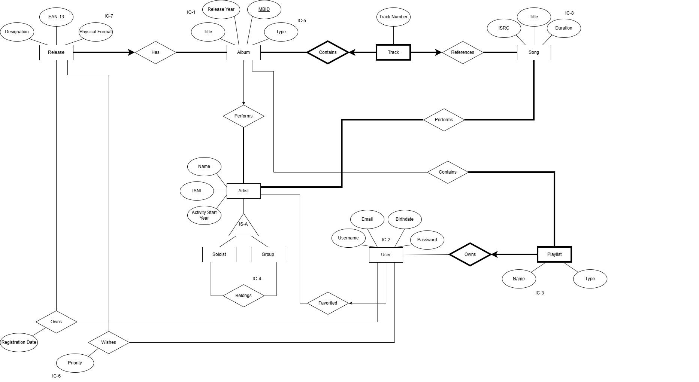

# Music Collection Database — Relational Database System & Enterprise PL/SQL Management Engine

[](LICENSE)
[](#academic-context--attribution)
[](#academic-context--attribution)
[](#getting-started)
[](#technical-specifications--system-architecture)
[](#technical-specifications--system-architecture)

A full-lifecycle relational database solution built for physical and digital music collection management, artist cataloging, and collection analytics. Developed on Oracle Database SQL and PL/SQL, the project spans all core stages of database systems engineering: Conceptual Design (E-R Modeling), Relational Schema Mapping, Advanced Analytical SQL Reporting, and an Enterprise-grade PL/SQL Data Access Engine enforcing complex Business Rules (RIAs).

<p align="center">
  
  <br>
  <em>Figure 1: Conceptual Entity-Relationship (E-R) Diagram for the Music Collection Database.</em>
</p>

> **Academic Context & Portfolio Preservation:** Developed in 2026 as a comprehensive group engineering project for the **Information Systems and Databases** (_Sistemas de Informação e Bases de Dados — SIBD_) course within the BSc in Software Engineering program at the **Faculty of Sciences of the University of Lisbon (FCUL)**. Delivered across sequential architectural phases, the project achieved a final grade of **18.5 / 20**. This repository was refactored and professionalized for portfolio preservation, clean technical documentation, and compliance with industry standards.

---

## Technical Specifications & System Architecture

- **Conceptual & Relational Modeling:** Fully normalized relational schema derived from an Entity-Relationship (E-R) diagram, ensuring strict entity integrity, key mapping (ISNI, EAN-13), and referential integrity across artists, albums, users, and collection holdings.
- **Analytical Query Engine:** Complex analytical SQL scripts utilizing multi-table joins, subqueries, grouping, aggregation, and window functions for collection analytics.
- **PL/SQL Package Engine (`pkg_colecao`):** Encapsulated data access layer written in Oracle PL/SQL implementing data mutation procedures, dynamic cursor generators (`SYS_REFCURSOR`), and automated collection metrics tracking.
- **Custom Exception Control Architecture:** Centralized error dispatching (`raise_error`) mapping declaratives and business constraints to custom application error codes (`-20001` to `-20010`).
- **Cascading Procedural Deletions:** Managed entity dependencies by enforcing strict procedural deletion delegation (`remove_artista` $\rightarrow$ `remove_album` $\rightarrow$ `remove_posse` and `remove_utilizador` $\rightarrow$ `remove_posse`).
- **Data Integrity & Business Rule Enforcement (RIAs):** Programmatic validation of domain constraints, such as artist activity timelines (RIA-08), minimum user age restrictions (RIA-15), and collection acquisition timing limits (RIA-16, RIA-17).

---

## System Overview & Component Structure

The system is structured across four progressive development phases:

```text
  ┌────────────────────────────────────────────────────────────────────────┐
  │                           SYSTEM LAYERS                                │
  ├────────────────────────────────────────────────────────────────────────┤
  │ 1. Conceptual Design    ──► E-R Diagram & Semantic Domain Rules        │
  │ 2. Relational Schema    ──► DDL Scripts, Keys & Declarative Integrity  │
  │ 3. Analytical Engine    ──► Advanced SQL Queries & Aggregations        │
  │ 4. PL/SQL Data Access   ──► pkg_colecao Engine & Automated Tests       │
  └────────────────────────────────────────────────────────────────────────┘
```

## Business Rules (RIAs) & PL/SQL Exception Map

All business logic constraints and runtime faults map directly to standard, isolated error codes:

| Code         | Exception Condition / Constraint Enforced                                |
| :----------- | :----------------------------------------------------------------------- |
| **`-20001`** | Generic integrity violation or internal system error.                    |
| **`-20002`** | Artist ISNI code does not exist in the database.                         |
| **`-20003`** | Album EAN code does not exist in the database.                           |
| **`-20004`** | Target username does not exist in the database.                          |
| **`-20005`** | Duplicate record insertion attempt (Primary Key / Uniqueness violation). |
| **`-20006`** | **RIA-08:** Album release year precedes the artist's career start year.  |
| **`-20007`** | **RIA-15:** User registration attempt under 13 years of age.             |
| **`-20008`** | **RIA-16:** Possession date year precedes the album release year.        |
| **`-20009`** | **RIA-17:** Possession date year precedes the year the user turned 13.   |
| **`-20010`** | Possession record does not exist for deletion attempt.                   |

---

## Getting Started

### Prerequisites

- Oracle Database Environment or Oracle SQL Developer / SQL\*Plus.
- Standard SQL CLI or DBMS tool for executing DDL/DML scripts.

### Build & Execution Sequence

1. **Initialize Database Schema & Tables:**  
   Execute the Stage 2/3 DDL script to create the relational tables (`artista`, `album`, `utilizador`, `possui`) and declarative constraints:
    ```sql
    @db/schema.sql
    ```
2. **Compile PL/SQL Package (Stage 4):**  
   Compile the interface specification and body into the Oracle Database:
    ```sql
    @etapa4/PKG_COLECAO.PKS
    @etapa4/PKG_COLECAO.PKB
    ```
3. **Run Suite of Unit Tests & Demonstrations:**  
   Execute the automated demonstration script to verify data seeding, workflows, and exception trapping:
    ```sql
    @etapa4/PKG_COLECAO.sql
    ```

## Repository Structure

```text
music-collection-database/
├── stage1/                    # Conceptual Design (E-R Diagrams)
│   ├── en/                    # English PDF diagrams
│   └── pt/                    # Portuguese PDF diagrams
├── stage2/                    # Relational Schema DDL & Data Population
│   ├── en/                    # English DDL (schema.sql & seed.sql)
│   └── pt/                    # Portuguese DDL (schema.sql & seed.sql)
├── stage3/                    # Analytical SQL & Business Logic Functions
│   ├── functions.sql          # Helper functions and business routines
│   ├── queries.sql            # Complex analytical SQL queries
│   ├── schema.sql             # Stage 3 schema refinements
│   └── README.md              # Stage 3 analytical documentation
├── stage4/                    # PL/SQL Package implementation & execution
│   ├── pkg_colecao.pks        # Package Specification (Interface & Exception Specs)
│   ├── pkg_colecao.pkb        # Package Body (Implementation Logic & Business Rules)
│   └── PKG_COLECAO.sql        # Execution Script & Automated Unit Test Suite
├── .gitignore                 # Exclusion rules for unwanted files
├── LICENSE                    # Project MIT License
└── README.md                  # Complete System Documentation
```

## Academic Context & Attribution

- **Core Architecture & Engineering:** Developed by Luís Pinto and project group members.
- **Academic Origin & Timeline:** Developed in 2026 for the Information Systems and Databases (Sistemas de Informação e Bases de Dados) course at the Faculty of Sciences, University of Lisbon (FCUL).
- **Evaluation:** Final Combined Grade Achieved: 18.5 / 20.
- **Specification & Base Schema:** Project guidelines and foundational requirements provided by FCUL course faculty.

### Academic Integrity Notice & Intellectual Property

- **Notice on Academic Integrity & IP:** This repository is published purely for portfolio preservation, technical demonstration, and educational purposes.
    - **For Current Students**: While the project license legally permits viewing and learning from this codebase, copying, modifying, or submitting any part of this code for official university coursework strictly violates the Academic Integrity Regulations of the Faculty of Sciences of the University of Lisbon (FCUL) and constitutes academic dishonesty/plagiarism.

**Disclaimer:** The author holds no responsibility for any misuse or academic misconduct committed by third parties.
